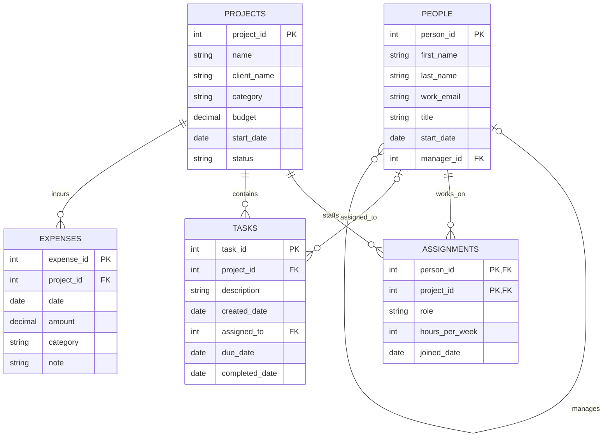

# BabsonAI Labs Database

## The Scenario

Scenario A, BabsonAI Labs: a 25-person startup that tracks people, projects, who works on what, tasks and expenses.

## The ERD

## What One Row Means

- One row of `people` is one person who works at BabsonAI Labs.
- One row of `projects` is one project the company has planned, is running, has paused or has finished.
- One row of `assignments` is one person's commitment to one project: their role, their hours a week, and the date they joined it.
- One row of `tasks` is one piece of work on one project.
- One row of `expenses` is one amount spent on one project.

## Design Choices

**The key where the business already had one.** People already have a work email, but the scenario says it changes when somebody changes title, so it cannot be a stable primary key. `people` uses a surrogate `person_id` instead, and keeps `work_email` as a `NOT NULL UNIQUE` column. The same reasoning applies to `projects`: a project's `name` is not guaranteed unique (two clients could want similarly named projects), so it gets a surrogate `project_id` too.

**The optional relationships.** `people.manager_id` is optional because "the two founders report to nobody." `tasks.assigned_to` is optional because "a new task may be unassigned." Every other foreign key (`assignments.person_id`, `assignments.project_id`, `tasks.project_id`, `expenses.project_id`) is required, because the scenario always ties those rows to exactly one project or person.

**The rule the tables cannot hold.** "A task is assigned only to somebody who works on its project, and never before that person's start date" spans three tables (`tasks`, `assignments`, `people`), and DuckDB's `CHECK` constraints only see one row of one table at a time. The tables cannot enforce it, so it is checked with a query instead: joining `tasks` to `assignments` on both the person and the project, and to `people` for the start date, then listing any task where no matching row exists or the task was created before the person started. That is the question marked *(checks a rule)*, answered in `questions.py`.

**What I changed from my agent's proposal.** My agent's first version of `make_data.py` assigned each task to any random member of the project's team, without checking that person's start date against the task's created date. Running the rule-check query from the question above against that data turned up about 35 tasks that broke "never before that person's start date," not the two I meant to break on purpose. I had it filter the team down to people who had already started by the task's created date before picking an assignee, then reran the same query to confirm only the two intended rows were left.
